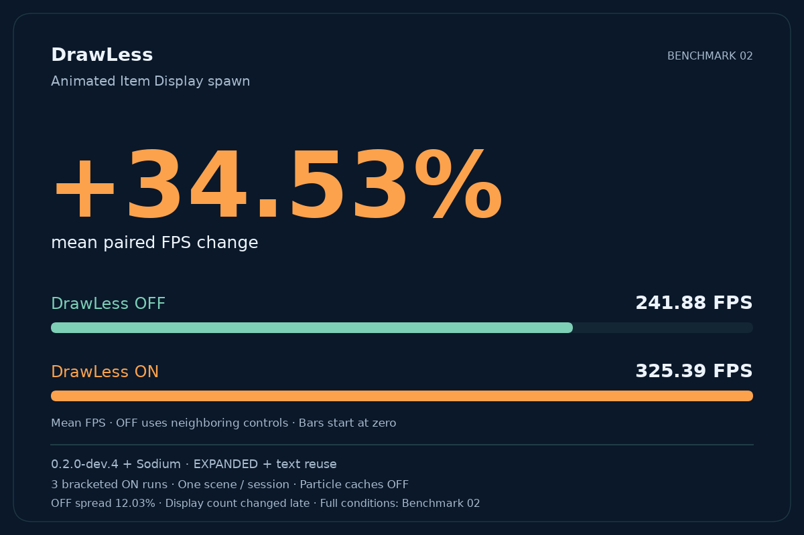

# DrawLess

**Less rendering work for busy Item Display scenes.**

DrawLess is a client-side optimization mod for Minecraft **26.2 / Fabric**,
focused on decorative Item Displays and animated ModelEngine NPCs. It reduces
repeated rendering work while keeping movement, animation and lighting live.

[Download on Modrinth](https://modrinth.com/mod/drawless) · [Benchmark results](benchmarks/README.md)

## What it offers

- Faster rendering of supported Item Display scenes through model and geometry reuse.
- Batching of compatible draws, with OFF, LIMITED and EXPANDED modes.
- Particle lighting and empty-collision optimizations, enabled by default for new settings.
- Player armor kept on the GPU: armor layers, trims and enchantment glint are drawn
  in a few calls instead of being rebuilt every frame.
- Items held and worn on the head by players kept on the GPU, including enchantment glint,
  sharing item models with Item Displays; glowing and translucent items keep vanilla rendering.
- Optional text/name-tag buffer reuse; each optimization has its own switch.
- A searchable settings menu with English and Russian translations.

## Getting started

Install **Fabric Loader 0.19.3+**, **Fabric API 0.161.0+26.2** and **Java 25**,
then place the DrawLess JAR in your Minecraft instance's `mods` folder.
Nothing needs to be installed on the server. **Sodium is optional.**

Press **F8** in-game to open settings. Rebind it under
**Options → Controls → Key Binds → DrawLess**.

Settings are grouped into Rendering, Players, Particles, Advanced and Diagnostics.
Search works across all categories; hover a setting for more information.
Drag numbers to adjust them, hold Shift for finer control, or use the keyboard.
Changes save automatically; resetting settings requires confirmation.
Existing configurations are preserved when updating.

## Compatibility

DrawLess works standalone or with Sodium; Sodium **0.9.2** is the tested version.
With **ImmediatelyFast**, overlapping text and batching optimizations are disabled
in DrawLess. With **Iris**, feature batching, GPU armor and GPU items on players are
disabled and Live geometry uses ordinary rendering. Unavailable controls explain why they cannot be changed.
With **Particle Core** or **AsyncParticles**, DrawLess disables its overlapping
particle caches. Iris and recognized dynamic-light integrations limit light reuse
to the current rendering pass.

**EXPANDED batching is enabled by default and can alter overlapping layers.**
If text backgrounds or other layers look incorrect, select **LIMITED** or **OFF**
under **Rendering → Feature batching**. Particle caches can be disabled
independently under **Particles**. They default to ON for new
settings; existing saved choices are preserved. **GPU armor** and **GPU items on
players** can be disabled under **Players**; they default to ON unless saved as OFF.
Text reuse defaults to OFF.
Keep **Live geometry** selected for normal play.

## Measured performance

One recorded scene measured **+34.53% mean paired FPS change**
(**241.88 → 325.39 FPS**) with **0.2.0-dev.4**, Sodium, EXPANDED batching and
text reuse; particle caches were OFF. Tested on a
Ryzen 5 5600H / RTX 3060 Laptop GPU. OFF controls varied by **12.03%**.

This is a scene-specific result from one session, not a benchmark of **1.2.0**
or a version-to-version improvement. See the [full report](benchmarks/README.md)
for all phases, raw measurements, conditions and limitations.

## Attributions

- **RK_01 / RaphiMC and ImmediatelyFast contributors** —
  [ImmediatelyFast](https://github.com/RaphiMC/ImmediatelyFast), specifically the
  [text and name-tag fast lookup approach in v1.16.5 for Minecraft 26.2](https://github.com/RaphiMC/ImmediatelyFast/tree/85b5f04bcb099f40fa9bb19bcd4c8cd1ec561ecc/common/src/main/java/net/raphimc/immediatelyfast/injection/mixins/fast_text_lookup).
  This informed DrawLess's own pass-scoped buffer reuse implementation, including
  active-buffer validation and shared handling for text and name tags. The IF
  glyph-renderer mixin classes are not incorporated. ImmediatelyFast's source
  remains under its [LGPL-3.0-or-later terms](https://github.com/RaphiMC/ImmediatelyFast/blob/85b5f04bcb099f40fa9bb19bcd4c8cd1ec561ecc/LICENSE).
- **RK_01 / RaphiMC and ImmediatelyFast contributors** — the
  [enhanced batching and scissor-state comparison approach](https://github.com/RaphiMC/ImmediatelyFast/tree/85b5f04bcb099f40fa9bb19bcd4c8cd1ec561ecc/common/src/main/java/net/raphimc/immediatelyfast/injection/mixins/enhanced_batching)
  informed DrawLess's own prepared-material comparison and optional promotion of
  ordered groups to reorderable batches. LIMITED retains vanilla order permissions;
  EXPANDED evaluates the broader reordering approach using the existing group list.
  IF's scissor and group mixin implementations are not incorporated.
- **LlamaLad7 and MixinExtras contributors** —
  [MixinExtras](https://github.com/LlamaLad7/MixinExtras), whose composable injection
  APIs are used by DrawLess's operation and method wrappers.
- **fzzyhmstrs and Particle Core contributors** —
  [Particle Core's position and tick-light reuse approaches](https://github.com/fzzyhmstrs/pc/tree/4b821baae8ffb86b6c180fdf1235e8c2f0bbfd94/src/main/java/me/fzzyhmstrs/particle_core/mixins)
  provided inspiration for DrawLess's particle position, light reuse and collision work.
