# DrawLess benchmarks

[Methodology](METHODOLOGY.md) · [0.1.0 correctness validation](VALIDATION_0.1.0.md) · [Rejected optimization experiments](../docs/REJECTED_OPTIMIZATIONS.md)

Benchmark 04 is the 1.4.0 release result with default settings and 12–17 other player models in the scene. Benchmark 03 is the 1.3.0 release result with default settings and 8–11 other player models. Benchmark 02 is a development-build/selected-preset result with no other players present. Benchmark 01 remains the published 0.1.0/default-preset result. None of them is a direct comparison between versions.

## Benchmark 04 — server spawn with players, 1.4.0

**+54.58% mean paired FPS change** across three bracketed ON comparisons in one recorded series. Mean bracketed OFF baseline **122.06 FPS**; mean ON **188.61 FPS**.

**This scene has more players in it than Benchmark 03.** Every phase renders **12–17 other player models** (14–19 players loaded, including me), with their bodies, armor and held items, next to **414–438 Item Displays** and roughly 1400–1600 particles. Benchmark 03 had 8–11 player models in view and a much lighter OFF baseline (about 180 FPS then, about 122 FPS now). The two percentages describe different scenes and are not a version-to-version comparison: a larger share of this frame is player rendering, which DrawLess now covers with bodies, armor and items.

**Measured build: 1.4.0** (the published artifact), Sodium, default settings: master switch OFF versus the 1.4.0 defaults (Live geometry, model cache with adaptive budget, EXPANDED batching, particle caches, GPU armor, GPU items on players and GPU player bodies ON; text reuse, NPC budget and paused display ticks OFF). ImmediatelyFast and Iris are absent.

[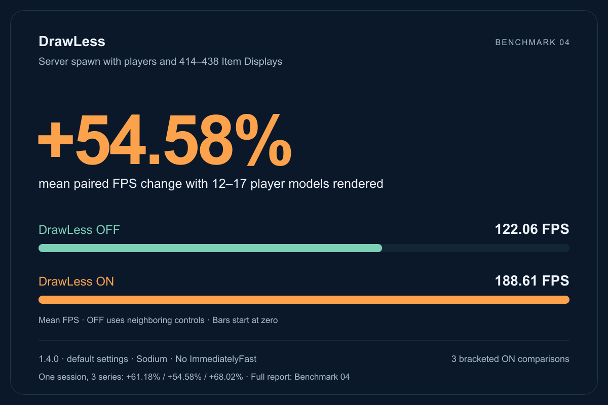](results/spawn-20261101/modrinth-card.png)

### Every recorded phase

The headline series is `release2`. Two more series were recorded at the same place in the same session; they are listed beside it, not added to it.

| Order | Phase | Mean observed FPS | Adjacent OFF baseline | Paired change | Rendered player models (mean) |
|---:|---|---:|---:|---:|---:|
| 1 | OFF1 | 116.32 | — | — | 16.05 |
| 2 | ON1 | 190.12 | 120.343 | +57.982% | 13.53 |
| 3 | OFF2 | 124.36 | — | — | 12.90 |
| 4 | ON2 | 185.04 | 124.290 | +48.874% | 13.21 |
| 5 | OFF3 | 124.22 | — | — | 13.50 |
| 6 | ON3 | 190.68 | 121.545 | +56.879% | 13.54 |
| 7 | OFF4 | 118.87 | — | — | 13.25 |

Each ON is compared with the arithmetic mean FPS of its immediately neighboring OFF phases; the headline is the arithmetic mean of the three percentage changes. All nine ON phases of the session exceed both of their neighboring OFF phases.

[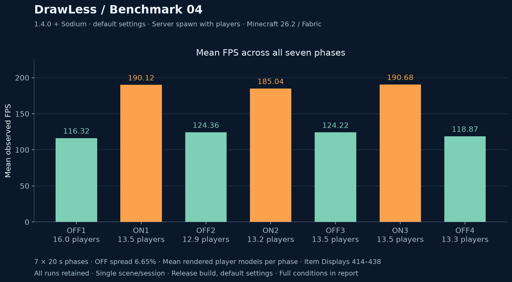](results/spawn-20261101/phase-fps.png)

| Series | Paired changes | Mean paired change | Population-adjusted mean | OFF range/mean |
|---|---|---:|---:|---:|
| release1 | +59.71 / +58.45 / +65.38% | +61.18% | +62.78% | 7.92% |
| **release2** | +57.98 / +48.87 / +56.88% | **+54.58%** | +52.89% | 6.65% |
| release3 | +61.49 / +74.04 / +68.52% | +68.02% | +60.22% | 16.52% |

I chose `release2` for the headline because it has the smallest OFF drift of the three and the lowest result. The three series are one session at one place, not independent sessions; their spread shows within-session variation only.

### Players in the scene and the population adjustment

Players walk in and out, so the number of rendered player models changes between phases (12–17 in `release2`). No avatar count was stable in every phase, so the exact population-matched comparison was not possible in any series. The regression-based adjustment shifts every phase to the series' mean population using a common within-phase slope of frame time per rendered player model (`release2`: 0.243 ± 0.057 ms per model). In `release2` it moves the result to +52.89%; with separate OFF and ON slopes it gives +54.58%, and the report flags that sensitivity. It is a descriptive correction for this one variable, not a model of the scene; the raw paired change stays the headline.

In `release3` a crowd arrived during the first OFF phase: up to 34 rendered player models (35 loaded), falling back to about 18 by the end of the series. That series has the largest OFF drift (16.52%) and the highest raw result; the population adjustment brings it to +60.22%. It is kept and reported, not removed. During that crowd the ON phases stayed at 147 FPS with 23–28 player models, while the first OFF phase ran at 88 FPS.

| Phase (`release2`) | Item Displays min–max | Bone carriers min–max | Loaded particles min–max | Loaded players min–max | Rendered player models min–max |
|---|---:|---:|---:|---:|---:|
| OFF1 | 414–426 | 320–330 | 1383–1558 | 17–19 | 15–17 |
| ON1 | 414–438 | 320–340 | 1399–1541 | 16–18 | 12–15 |
| OFF2 | 414–414 | 320–320 | 1384–1509 | 14–17 | 12–14 |
| ON2 | 414–438 | 320–340 | 1390–1551 | 15–17 | 13–14 |
| OFF3 | 414–416 | 320–321 | 1441–1590 | 15–16 | 13–14 |
| ON3 | 414–416 | 320–321 | 1429–1547 | 15–16 | 13–14 |
| OFF4 | 414–426 | 320–330 | 1401–1554 | 15–16 | 13–14 |

Rendered player models are avatar render states (players and mannequins) after frustum culling, sampled over every measured frame between one-second samples; loaded players include me. The Item Display population changes by up to 24 entries during `release2`, above the 2% screening threshold. Particle counts fluctuate naturally. No samples were selected by population to replace the full-phase result.

### Measured retained geometry costs

[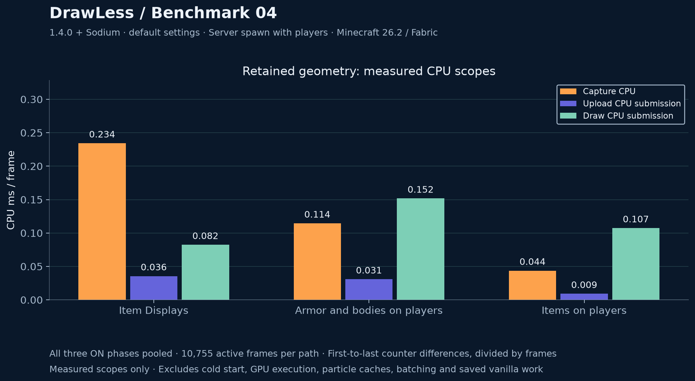](results/spawn-20261101/retained-cpu.png)

Three owners keep geometry on the GPU in this scene: Item Displays (Live geometry), armor and bodies on players (one owner with shared meshes and draws) and items on players. Their measured CPU scopes are pooled over the three ON phases of `release2` (10,755 active frames per path), using first-to-last sample differences of cumulative counters, divided by frames. Body capture is reported separately by the armor owner and is included in its capture column.

| Path | Capture CPU ms/frame | Upload CPU ms/frame | Draw CPU ms/frame | Sum |
|---|---:|---:|---:|---:|
| Item Displays | 0.234 | 0.036 | 0.082 | 0.352 |
| Armor and bodies on players | 0.114 | 0.031 | 0.152 | 0.297 |
| Items on players | 0.044 | 0.009 | 0.107 | 0.160 |

Together the paths cost about 0.81 ms of measured CPU per frame. This is the price inside the named scopes, not the net effect: the vanilla work they replace is not counted here, and GPU execution, particle caches, feature batching and other overhead are not included. Per frame, the ON phases report 218–239 Item Display parts in one draw, 36–44 armor pieces and 11–13 player bodies in three draws (1–2 bodies with semi-transparent skins stay on the ordinary path) and 25–30 player item stacks in two to three draws (4 translucent stacks stay on the ordinary path).

### Review findings and limitations

- One scene, one session, one machine. No confidence interval, independent-session repeat, p95/p99, 1% low or GPU elapsed time is available.
- OFF drift exceeds the 5% screening threshold in all three series (6.65–16.52%); the population adjustment corrects only the number of rendered player models.
- The FPS slider was at its maximum (260, shown as Unlimited), so no frame limiter was active.
- AFK frame throttling was paused by the series and restored afterwards.
- The result is for the whole of DrawLess at its defaults; it does not separate Item Display, player, particle and batching contributions.
- No synchronized pixel comparison was taken in this series.

### Artifact and environment

- Recorded 2026-11-01, 18:50–19:02 Europe/Moscow (UTC+03:00); `release2` 18:54–18:57. Dimension `minecraft:spawn/overworld-ba66`; camera `1.19 / 101.62 / 3.42`, yaw/pitch `126.55 / 18.57`, unchanged in all 140 samples of `release2`; first person, FOV 110, render distance 7, GUI scale 2.
- Framebuffer 1920×1129, FPS slider 260 (Unlimited), VSync OFF, resource packs `vanilla` and a server resource pack, detailed profiler OFF. All phases completed with 20 samples, zero excluded menu frames and zero unfocused measured frames.
- Artifact: `drawless-1.4.0.jar`; SHA-256 `493c04b1225463a013740312d5646c4a75f670b11f0c9c4fc66ca2626f21854e`. Source: `58e765ee18ef0747845534efa7d4c1be628e2d4f` (merged as `d94aab6ac91ad74e2774c4c1b3db2a20e342643e`).
- Minecraft 26.2, Fabric Loader 0.20.0, Fabric API 0.161.0+26.2, Sodium 0.9.2+mc26.2, Java 25.0.4. AMD Ryzen 5 5600H; NVIDIA GeForce RTX 3060 Laptop GPU (hardware from the current system inventory, not from the series files).
- Settings before each series were the 1.4.0 defaults; each series restored them afterwards.

### Raw measurements and hashes

Original files of all three series, byte-for-byte: [`results/spawn-20261101/raw/`](results/spawn-20261101/raw/), with SHA-256 for every file in [`SHA256SUMS.txt`](results/spawn-20261101/raw/SHA256SUMS.txt). Each series folder holds its generated summary (`README.md`, `summary.json`) and the seven phase reports.

| Phase (`release2`) | Original file | SHA-256 |
|---|---|---|
| OFF1 | [drawless-20261101-185442-811-release2_off1.md](results/spawn-20261101/raw/benchmark-20261101-185420-781-release2/drawless-20261101-185442-811-release2_off1.md) | `723dae8e16231014a5c73c59858931e6cd0fd8e7323306614561187440bf1e7b` |
| ON1 | [drawless-20261101-185504-823-release2_on1.md](results/spawn-20261101/raw/benchmark-20261101-185420-781-release2/drawless-20261101-185504-823-release2_on1.md) | `1ec3a243263ef3149e0f731f92fe6b96aebac80f3184bf978fcab2f354ed8b97` |
| OFF2 | [drawless-20261101-185526-837-release2_off2.md](results/spawn-20261101/raw/benchmark-20261101-185420-781-release2/drawless-20261101-185526-837-release2_off2.md) | `8d8a876d39ee6b351116a076da94a893493a80b62ec5b3caa44caef49e3dcbce` |
| ON2 | [drawless-20261101-185548-854-release2_on2.md](results/spawn-20261101/raw/benchmark-20261101-185420-781-release2/drawless-20261101-185548-854-release2_on2.md) | `0297dc591965a67e9bede56672daeb88eefb21586b9d34bee15e7c91f6ada9ea` |
| OFF3 | [drawless-20261101-185610-873-release2_off3.md](results/spawn-20261101/raw/benchmark-20261101-185420-781-release2/drawless-20261101-185610-873-release2_off3.md) | `8dbe14a7a4040847ac46b1b4ff3943d9ee97015dfb3abce65de4a5f0146bb252` |
| ON3 | [drawless-20261101-185632-889-release2_on3.md](results/spawn-20261101/raw/benchmark-20261101-185420-781-release2/drawless-20261101-185632-889-release2_on3.md) | `72bd3644f51b3f571b40766180e314807820098071d9b55f415ed70bc6216a32` |
| OFF4 | [drawless-20261101-185654-907-release2_off4.md](results/spawn-20261101/raw/benchmark-20261101-185420-781-release2/drawless-20261101-185654-907-release2_off4.md) | `960a2f072da01adf8fe9fc3906cf8189c5bf8b419b52c80a3f85262eb19e739e` |

---

## Benchmark 03 — server spawn with players, 1.3.0

**+29.24% mean paired FPS change** across three bracketed ON comparisons in one recorded series. Mean bracketed OFF baseline **179.50 FPS**; mean ON **231.99 FPS**.

**This scene has players in it.** Every phase renders **8–11 other player models** (9–13 players loaded, including me), with their armor and held items, next to **426–438 Item Displays** and roughly 1000–1800 particles. Benchmarks 01 and 02 were recorded with no other players present (one loaded player: me). Benchmark 03 therefore measures DrawLess across a whole populated scene, not only Item Displays; its percentage is not comparable with the +34.53% of Benchmark 02 as a version-to-version change.

**Measured build: 1.3.0** (release candidate, the published artifact), Sodium, default settings: master switch OFF versus the 1.3.0 defaults (Live geometry, model cache with adaptive budget, EXPANDED batching, particle caches, GPU armor and GPU items on players ON; text reuse, NPC budget and paused display ticks OFF). ImmediatelyFast is absent.

[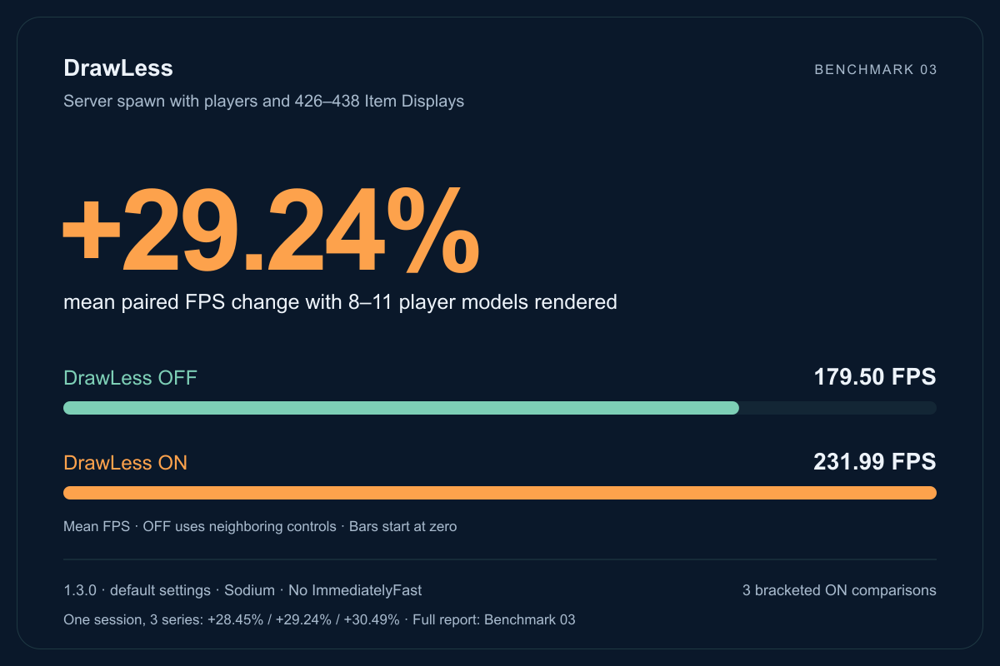](results/spawn-20261031/modrinth-card.png)

### Every recorded phase

The headline series is `release2`. Two more series were recorded at the same camera in the same session; they are listed beside it, not added to it.

| Order | Phase | Mean observed FPS | Adjacent OFF baseline | Paired change | Rendered player models (mean) |
|---:|---|---:|---:|---:|---:|
| 1 | OFF1 | 178.70 | — | — | 8.98 |
| 2 | ON1 | 229.56 | 178.947 | +28.284% | 8.66 |
| 3 | OFF2 | 179.20 | — | — | 8.35 |
| 4 | ON2 | 233.32 | 179.157 | +30.233% | 8.68 |
| 5 | OFF3 | 179.12 | — | — | 9.38 |
| 6 | ON3 | 233.08 | 180.401 | +29.203% | 10.14 |
| 7 | OFF4 | 181.69 | — | — | 9.22 |

Each ON is compared with the arithmetic mean FPS of its immediately neighboring OFF phases; the headline is the arithmetic mean of the three percentage changes. All nine ON phases of the session exceed both of their neighboring OFF phases.

[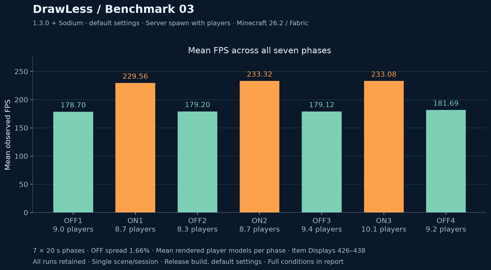](results/spawn-20261031/phase-fps.png)

| Series | Paired changes | Mean paired change | Population-adjusted mean | OFF range/mean |
|---|---|---:|---:|---:|
| release1 | +28.75 / +28.26 / +28.35% | +28.45% | +30.35% | 3.19% |
| **release2** | +28.28 / +30.23 / +29.20% | **+29.24%** | +29.97% | 1.66% |
| release3 | +31.27 / +31.40 / +28.80% | +30.49% | +31.58% | 12.44% |

I chose `release2` for the headline because it has the smallest OFF drift and no uncertainty flag on its population adjustment. The three series are one session at one place, not independent sessions; their spread shows within-session variation only.

### Players in the scene and the population adjustment

Players walk in and out, so the number of rendered player models changes between phases (8–11 in `release2`). No avatar count was stable in every phase, so the exact population-matched comparison was not possible in any series. The report therefore also gives a regression-based adjustment: a common within-phase slope of frame time per rendered player model (`release2`: 0.133 ± 0.032 ms per model) shifts every phase to the series' mean population. It moves the result by +0.7 to +1.9 percentage points in the three series. It is a descriptive correction for this one variable, not a model of the scene; the raw paired change stays the headline.

In `release3` the last OFF phase drops to 159.56 FPS after the scene changed (10 player models from that point on). That series has the largest OFF drift (12.44%), and its report flags the adjusted pairs as rough: the uncertainty of the population shift reaches 1.16% of a phase's frame time. It is kept and reported, not removed.

| Phase (`release2`) | Item Displays min–max | Bone carriers min–max | Loaded particles min–max | Loaded players min–max | Rendered player models min–max |
|---|---:|---:|---:|---:|---:|
| OFF1 | 426–426 | 312–312 | 1668–1807 | 9–10 | 8–9 |
| ON1 | 426–438 | 312–323 | 1714–1834 | 9–10 | 8–9 |
| OFF2 | 426–438 | 312–323 | 1625–1730 | 10–12 | 8–9 |
| ON2 | 438–438 | 323–323 | 1587–1769 | 11–12 | 8–10 |
| OFF3 | 426–438 | 312–323 | 1571–1805 | 10–11 | 9–10 |
| ON3 | 426–426 | 312–312 | 1641–1812 | 11–12 | 10–11 |
| OFF4 | 426–426 | 312–312 | 1606–1823 | 10–11 | 9–10 |

Rendered player models are avatar render states (players and mannequins) after frustum culling, sampled over every measured frame between one-second samples; loaded players include me. The Item Display population changes by 12 entries during `release2`, above the 2% screening threshold. Particle counts fluctuate naturally. No samples were selected by population to replace the full-phase result.

### Measured retained geometry costs

[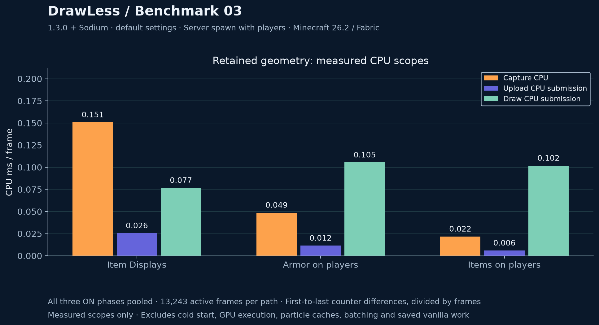](results/spawn-20261031/retained-cpu.png)

Three paths keep geometry on the GPU in this scene: Item Displays (Live geometry), armor on players and items on players. Their measured CPU scopes are pooled over the three ON phases of `release2` (13,243 active frames per path), using first-to-last sample differences of cumulative counters, divided by frames.

| Path | Capture CPU ms/frame | Upload CPU ms/frame | Draw CPU ms/frame | Sum |
|---|---:|---:|---:|---:|
| Item Displays | 0.151 | 0.026 | 0.077 | 0.253 |
| Armor on players | 0.049 | 0.012 | 0.105 | 0.166 |
| Items on players | 0.022 | 0.006 | 0.102 | 0.130 |

Together the three paths cost about 0.55 ms of measured CPU per frame. This is the price inside the named scopes, not the net effect: the vanilla work they replace is not counted here, and GPU execution, particle caches, feature batching and other overhead are not included. Per frame, the ON phases report 212–224 Item Display parts in one draw, 25–32 armor pieces in two draws and 15–21 player item stacks in two draws; translucent player items stay on the ordinary path.

### Review findings and limitations

- One scene, one session, one machine. No confidence interval, independent-session repeat, p95/p99, 1% low or GPU elapsed time is available.
- The FPS slider was at its maximum (260, shown as Unlimited), so no frame limiter was active; per-second ON values reached at most 252 FPS. (Corrected 2026-11-01: an earlier version of this item treated 260 as an active limit.)
- AFK frame throttling was paused by the series and restored afterwards.
- The result is for the whole of DrawLess at its defaults; it does not separate Item Display, player, particle and batching contributions.
- No synchronized pixel comparison was taken in this series.

### Artifact and environment

- Recorded 2026-10-31, 22:10–22:18 Europe/Moscow (UTC+03:00). Dimension `minecraft:spawn/overworld-41f2`; camera `-8.79 / 100.62 / -5.55`, yaw/pitch `112.47 / 4.27`, unchanged in all 420 samples; first person, FOV 110, render distance 7, GUI scale 2.
- Framebuffer 1920×1129, FPS slider 260 (Unlimited), VSync OFF, resource packs `vanilla` and a server resource pack, detailed profiler OFF. All phases completed with 20 samples, zero excluded menu frames and zero unfocused measured frames.
- Artifact: `drawless-1.3.0.jar`; SHA-256 `a3a717007d1cb78096f48916a6aaf39693e6415d319b079a975c0e1d38c8038b`. Source: `13eda58ba949e6bf145b2a720e175cd1e686913d`.
- Minecraft 26.2, Fabric Loader 0.20.0, Fabric API 0.161.0+26.2, Sodium 0.9.2+mc26.2, Java 25.0.4. AMD Ryzen 5 5600H; NVIDIA GeForce RTX 3060 Laptop GPU (hardware from the current system inventory, not from the series files).
- Settings before each series were the 1.3.0 defaults; each series restored them afterwards.

### Raw measurements and hashes

Original files of all three series, byte-for-byte: [`results/spawn-20261031/raw/`](results/spawn-20261031/raw/), with SHA-256 for every file in [`SHA256SUMS.txt`](results/spawn-20261031/raw/SHA256SUMS.txt). Each series folder holds its generated summary (`README.md`, `summary.json`) and the seven phase reports.

| Phase (`release2`) | Original file | SHA-256 |
|---|---|---|
| OFF1 | [drawless-20261031-221329-204-release2_off1.md](results/spawn-20261031/raw/benchmark-20261031-221307-194-release2/drawless-20261031-221329-204-release2_off1.md) | `8a3558c7e54f62423357a881e42e6f97cb17d82e915f91a739c62ec7720c120c` |
| ON1 | [drawless-20261031-221351-214-release2_on1.md](results/spawn-20261031/raw/benchmark-20261031-221307-194-release2/drawless-20261031-221351-214-release2_on1.md) | `1ef4a018cd0959d4b9de2c516e5ef62b74fcc9ad3f9d3e9f937a7f0d3002be2e` |
| OFF2 | [drawless-20261031-221413-225-release2_off2.md](results/spawn-20261031/raw/benchmark-20261031-221307-194-release2/drawless-20261031-221413-225-release2_off2.md) | `826095e42e66ab97f4e4172dd6e065557afd9dab615fe608e960406e5b8aaeeb` |
| ON2 | [drawless-20261031-221435-234-release2_on2.md](results/spawn-20261031/raw/benchmark-20261031-221307-194-release2/drawless-20261031-221435-234-release2_on2.md) | `7f7457c7aecc0664d2c4ce9b77d4618d68cf0b19c089c8aa2ff78cf9ea3b5d0e` |
| OFF3 | [drawless-20261031-221457-248-release2_off3.md](results/spawn-20261031/raw/benchmark-20261031-221307-194-release2/drawless-20261031-221457-248-release2_off3.md) | `5bba1082d04ed51069fa68475abc55373971039022d56eb3891471f112500914` |
| ON3 | [drawless-20261031-221519-260-release2_on3.md](results/spawn-20261031/raw/benchmark-20261031-221307-194-release2/drawless-20261031-221519-260-release2_on3.md) | `e9aa98202d034a998224459a20d7d7f333cf233fb196c0789340bffbb11696b6` |
| OFF4 | [drawless-20261031-221541-268-release2_off4.md](results/spawn-20261031/raw/benchmark-20261031-221307-194-release2/drawless-20261031-221541-268-release2_off4.md) | `709b0ad779085fbf1af7ffe110f72efa38d9981180fefd13aaad0d8702c4a619` |

---

## Benchmark 02 — animated Item Display spawn

**+34.53% mean paired FPS change** across three bracketed ON comparisons in one recorded scene/session. Mean bracketed OFF baseline **241.88 FPS**; mean ON **325.39 FPS**.

**Measured build: 0.2.0-dev.4**, with Sodium, EXPANDED feature batching and text buffer reuse ON; particle light/collision caches OFF. This is master OFF versus that selected ON preset. It is not a comparison of version 0.1.0 with 0.2.0 and is not a benchmark of final 0.2.0 defaults (text reuse defaults OFF).

### Every recorded phase

| Order | Phase | Mean observed FPS | Adjacent OFF baseline | Paired change |
|---:|---|---:|---:|---:|
| 1 | OFF1 | 259.42 | — | — |
| 2 | ON1 | 337.65 | 250.400 | +34.844% |
| 3 | OFF2 | 241.38 | — | — |
| 4 | ON2 | 320.78 | 235.670 | +36.114% |
| 5 | OFF3 | 229.96 | — | — |
| 6 | ON3 | 317.74 | 239.555 | +32.638% |
| 7 | OFF4 | 249.15 | — | — |

Each ON is compared with the arithmetic mean FPS of its immediately neighboring OFF phases. The headline is the arithmetic mean of all three percentage changes; it differs slightly from the ratio of the aggregate means. All seven original files are retained.

[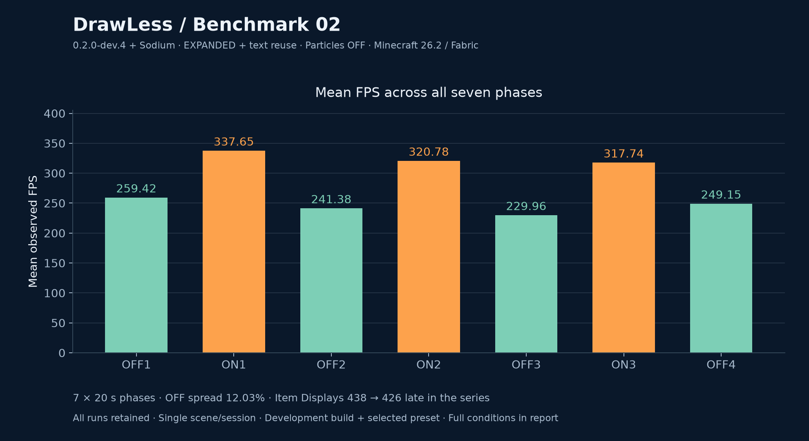](results/spawn-20261017/phase-fps.png)

### Review findings and limitations

OFF values are 259.42 / 241.38 / 229.96 / 249.15 FPS: range/mean **12.03%**, above the methodology screening threshold of 5%. ON3 changes from 438 to 426 Item Displays; OFF4 remains at 426. This exceeds the 2% population screening threshold. These flags were manually reviewed and disclosed; they are not grounds for deleting runs, nor are they significance tests. Bracketing cannot remove arbitrary time/server/hardware confounding.

All three ON values exceed both neighboring OFF values, with paired descriptive changes +34.84%, +36.11% and +32.64%. The result supports a positive scene-specific signal; it does not establish a universal effect size, an independent-session confidence interval or the separate contribution of batching/text reuse/Live geometry. Do not add this percentage to Benchmark 01 or describe it as a 0.1.0-to-0.2.0 increase.

### Scene, workload and fidelity

Recorded 2026-10-17, 15:51–15:54 Europe/Moscow (UTC+03:00). PrisonEvo-1 #5; dimension `minecraft:spawn/overworld_halloween-b2b1`. Camera `-21.39 / 99.12 / 0.95`, yaw/pitch `90.84 / 6.29`, FOV 110, render distance 7, GUI scale 2. All 140 samples retain the same camera, one player, focus and detailed-profiler OFF. Every phase completed with 20 samples, zero excluded menu frames and zero unfocused measured frames.

| Phase | Item Displays min–max | Bone carriers min–max | Loaded particles min–max |
|---|---:|---:|---:|
| OFF1 | 438–438 | 296–296 | 1842–2064 |
| ON1 | 438–438 | 296–296 | 1793–2034 |
| OFF2 | 438–438 | 296–296 | 1895–2010 |
| ON2 | 438–438 | 296–296 | 1872–1971 |
| OFF3 | 438–438 | 296–296 | 1763–1977 |
| ON3 | 426–438 | 286–296 | 1926–2040 |
| OFF4 | 426–426 | 286–286 | 1833–2075 |

ON3 has four samples with 438 Item Displays and sixteen with 426. Counts of bone carriers do not prove animated-bone counts or identical visible workload. Particle populations fluctuate naturally; ON does not consistently have fewer particles. No samples were selected by population to replace the full-phase result.

I confirmed unchanged appearance in every ON phase, unchanged resources, unlimited FPS, VSync OFF, a maximized window, AC power and Performance mode. This is my visual observation, not synchronized pixel parity. Known controlled EXPANDED counterexamples can change overlapping alpha or opaque layers; no universal layer equivalence is claimed.

### Measured Live geometry costs

[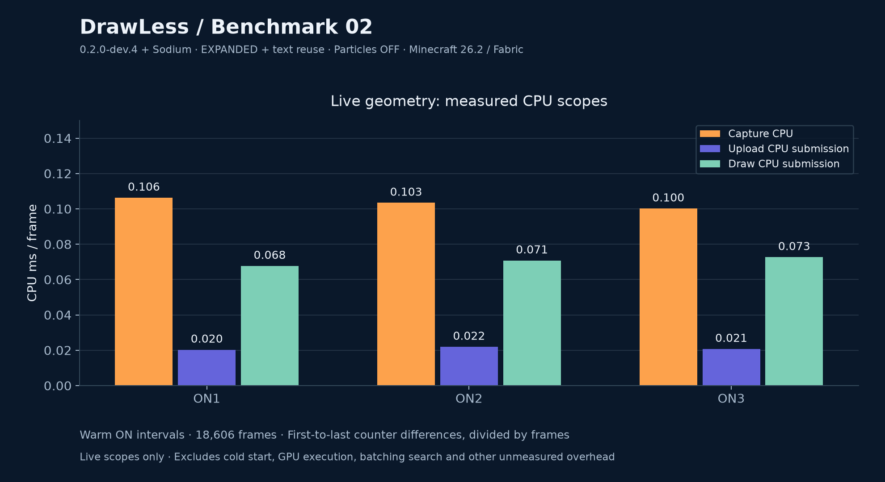](results/spawn-20261017/cache-cpu.png)

Values below use cumulative counter differences over the first-to-last sampled ON intervals, not one instantaneous cost or a cumulative total from before the run. Timings include the work within the named Live scopes. They exclude other rendering/optimization costs and do not measure GPU execution.

| Phase | Interval frames | Capture CPU ms/frame | Upload CPU ms/frame | Draw CPU ms/frame |
|---|---:|---:|---:|---:|
| ON1 | 6420 | 0.106283 | 0.020285 | 0.067689 |
| ON2 | 6104 | 0.103410 | 0.021907 | 0.070746 |
| ON3 | 6082 | 0.100157 | 0.020724 | 0.072646 |

Each ON sample reports 162 cached meshes, 455424 bytes of local geometry and one draw in the custom Live path; 205–209 instances, variable fallbacks and roughly 26.6 kB/frame of instance upload traffic. These are not whole-game draw counts, total VRAM or retained instance-memory estimates. The cost figure is not the complete price of all enabled optimizations.

### Artifact and environment

- Artifact: `drawless-0.2.0-dev.4.jar`; SHA-256 `44b2d2741b9d134e7dcbf4b58728e1586d4744f79654f767818dd1ce9671a72c`. The currently installed JAR matches the previously recorded dev.4 artifact hash; its file timestamp precedes the series.
- Source: `92f8ffc2715b34e649446799402c457db19c982c`.
- AMD Ryzen 5 5600H; NVIDIA GeForce RTX 3060 Laptop GPU. CPU checked by current system inventory; GPU, NVIDIA 610.62/OpenGL, Sodium 0.9.2+mc26.2, Fabric Loader 0.20.0 and Fabric API 0.161.0+26.2 are present in the recording-session log. ImmediatelyFast is absent.
- Exact framebuffer dimensions, Java runtime build, JVM heap/arguments and resource-pack version were not recorded. Current settings are not substituted for historical settings.
- The explicit probe has coarse/sampled diagnostic overhead. No calibrated recorder overhead, full per-frame trace, p95/p99, 1% low, GPU elapsed times or thermal/clock trace is available.

### Raw measurements and hashes

| Phase | Original file | SHA-256 |
|---|---|---|
| OFF1 | [drawless-20261017-155121-748-off1.md](results/spawn-20261017/raw/drawless-20261017-155121-748-off1.md) | `f061a81a9c8bf97392cbffe2d26d75bb0101afd7e347f7c2ebf6389f5ee9a16f` |
| ON1 | [drawless-20261017-155151-299-on1.md](results/spawn-20261017/raw/drawless-20261017-155151-299-on1.md) | `e7a4b3a4a800458dcd0c75a6beea4e8cf3e44ad8ed98f9d775513cd4694adbed` |
| OFF2 | [drawless-20261017-155220-742-off2.md](results/spawn-20261017/raw/drawless-20261017-155220-742-off2.md) | `d82af6db10519fc0076641a8a399da302eb361e4ba561b3c13db24d6e12449a7` |
| ON2 | [drawless-20261017-155250-548-on2.md](results/spawn-20261017/raw/drawless-20261017-155250-548-on2.md) | `cd90c0397e0c2c9b80471d750a5364778ceaf93f14305ffbf5f96242ea2be147` |
| OFF3 | [drawless-20261017-155320-522-off3.md](results/spawn-20261017/raw/drawless-20261017-155320-522-off3.md) | `92f9a5106dfd4f7d9dff72162a626ae8d23a35d01829dc2f1cef800589aab072` |
| ON3 | [drawless-20261017-155351-381-on3.md](results/spawn-20261017/raw/drawless-20261017-155351-381-on3.md) | `2d0e3c2dd2179371183c42c96801ab4dc337272f31fc03413e2e89f765cb621c` |
| OFF4 | [drawless-20261017-155422-642-off4.md](results/spawn-20261017/raw/drawless-20261017-155422-642-off4.md) | `7ef7de13b457a709617a546cd1c5ed238401d28217c2e22d5ef28046fb9df429` |

All raw files are preserved byte-for-byte. This report and figures describe the observed series, including its control drift and workload changes. The older Benchmark 01 remains a separate 0.1.0 result.

---

## Benchmark 01 — animated Item Display spawn

Recorded 2026-10-16, analysed 2026-10-17. DrawLess **0.1.0 with Sodium**, without
ImmediatelyFast, improved mean observed FPS by **21.24% across three bracketed ON
comparisons** in this scene. The mean bracketed OFF baseline is **242.91 FPS**;
mean ON is **294.50 FPS**.

[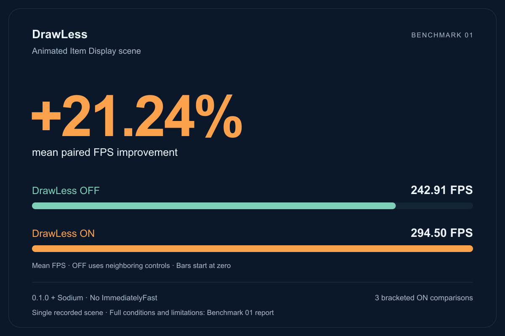](results/spawn-20261016/modrinth-card.png)

This compares the DrawLess master switch OFF with its default optimization set ON.
It does not isolate one cache, compare against ImmediatelyFast or establish gains
for other scenes, computers or GPU-bound settings.

### Every recorded phase

Each ON is compared with the arithmetic mean FPS of the immediately neighboring
OFF controls. The headline is the mean of the three percentage changes.

| Order | Phase | Mean observed FPS | Adjacent OFF baseline | Paired change |
|---:|---|---:|---:|---:|
| 1 | OFF1 | 243.24 | — | — |
| 2 | ON1 | 295.31 | 243.645 | +21.205% |
| 3 | OFF2 | 244.05 | — | — |
| 4 | ON2 | 296.10 | 244.600 | +21.055% |
| 5 | OFF3 | 245.15 | — | — |
| 6 | ON3 | 292.09 | 240.495 | +21.454% |
| 7 | OFF4 | 235.84 | — | — |

[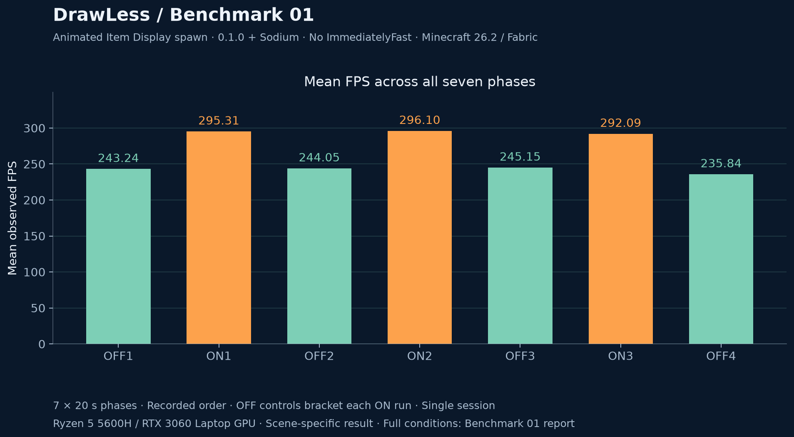](results/spawn-20261016/phase-fps.png)

All seven reports are retained. OFF4 is lower than the previous controls: OFF
max-minus-min divided by mean is **3.85%**. Bracketing incorporates this control;
it cannot remove arbitrary server changes, thermal drift or time-order effects.
The unpaired means of all four OFF and all three ON runs are 242.07 and 294.50 FPS;
those are a different calculation from the headline baseline.

Three ON runs in one session are preliminary repeated observations, not independent
sessions or a statistical confidence estimate. No p99/1% low is derived from the
approximately once-per-second displayed-FPS samples.

### Scene and fidelity

PrisonEvo-1 #5, dimension `spawn/overworld-dbb2`, camera XYZ `-21.34 / 99.12 / 0.99`,
yaw/pitch `89.89 / 4.48`, FOV 110, render distance 7, GUI scale 2.

Across all **140 scene samples**: 569 loaded Display entities, 563 Item Display,
407 bone carriers, 530 custom-model-data items, 439 passengers and one player.
Recorded camera values are identical. Each phase completed with 20 samples;
menu frames excluded and unfocused measured frames are zero in every report.
Bone-carrier count does not mean every carrier is an animated bone. Rounded
camera samples and object counts do not establish continuous camera immobility
or identical visible output.

I saw unchanged NPC appearance, animation, lighting and visible
parts in every ON phase. NPC pose budgeting, tick pausing, particle-light and
particle-collision experiments were OFF. This is an observation and supporting
counter evidence, not a synchronized pixel-parity test.

Mean loaded particles ranged from 1571.95 to 1646.90 across phases. The population
fluctuated naturally; ON did not consistently have fewer loaded particles.
Loaded counts are not visible-particle counts.

### What the optimization costs

CPU values use cumulative counter differences over the first-to-last sample
intervals of the ON runs, weighted by their combined **16,835 frames**. These
intervals omit recording edges and are already warm.

| Measured work | CPU ms/frame |
|---|---:|
| Live geometry capture | 0.16566 |
| Live upload submission | 0.02636 |
| Live draw submission | 0.07624 |

[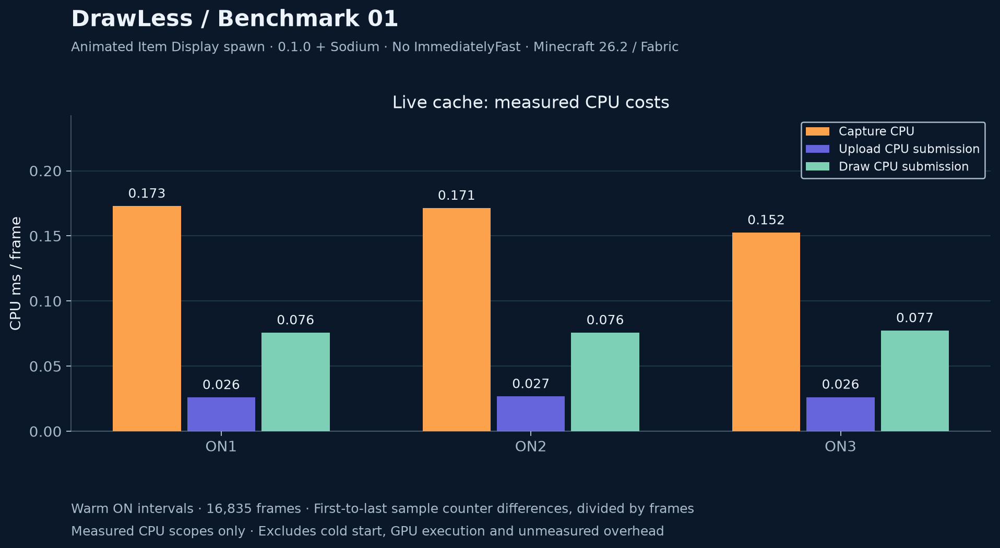](results/spawn-20261016/cache-cpu.png)

These are specific CPU scopes, not total optimization overhead. They exclude
cold-start construction, model-layer refresh, recorder overhead and GPU execution.
Do not add them to inclusive scopes that already contain their work.

- Shared local geometry: **518,912 bytes = 506.75 KiB**, 210 retained meshes.
- Sampled index buffers: **115,920–116,496 bytes** across ON runs.
- Instance-buffer traffic: weighted **36,452 bytes/frame ≈35.60 KiB/frame**.
- Cached parts per sampled frame: **282–286**; one cached-scene draw per sampled frame.
- Ordinary prepared Item Display states: 333 in OFF, 47–51 in ON, including 32 empty
  states. These counts exclude GPU-cached parts and do not indicate missing models.
- No new mesh builds or local-geometry uploads between the first and last ON samples.
  This does not measure the initial cache construction cost.

Tracked buffers are not total GPU memory; traffic per frame is not retained VRAM.

### Environment and limitations

- Measured JAR: `drawless-0.1.0.jar`, SHA-256
  `3d69eb5f7ad88730327a97068b78c2c525a87948e7bbb960056454ca61eceb3b`.
  The installed file was checked after recording and matches the archived artifact.
- Recording-session log: Minecraft 26.2, Fabric Loader **0.20.0**, Fabric API
  0.161.0+26.2, DrawLess 0.1.0, Sodium 0.9.2+mc26.2; no ImmediatelyFast.
- GPU/driver from that log: NVIDIA GeForce RTX 3060 Laptop GPU, NVIDIA 610.62, OpenGL.
- CPU from system inventory at analysis: AMD Ryzen 5 5600H; nominal 32 GB system RAM.
- Confirmed by me during the run: maximized window, unlimited FPS, VSync OFF, AC power,
  Performance mode.
- Java major version 25 is logged. Exact Java build, JVM heap/arguments, framebuffer
  dimensions, full graphics preset and resource-pack version at measurement were
  not captured. Warmup/wait timing was not independently recorded.

Missing details limit exact reproduction. Current settings are not substituted for
historical evidence. Original session logs contain unrelated private information
and remain local. These results describe one recorded scene and one session.

### Original inputs

All seven original reports are preserved byte-for-byte in
[raw/](results/spawn-20261016/raw/). The identifiers below verify their contents.

| Phase | Original report | SHA-256 |
|---|---|---|
| OFF1 | [drawless-20261016-235418-647-spawn_off1.md](results/spawn-20261016/raw/drawless-20261016-235418-647-spawn_off1.md) | `7fc51a27493a133999a10a159c7d2a6e04bcfa272746ca2d811d7612e9f90001` |
| ON1 | [drawless-20261016-235458-741-spawn_on1.md](results/spawn-20261016/raw/drawless-20261016-235458-741-spawn_on1.md) | `f7e392f98d91cd959f0c1dedafe73a19ea9e56bf7a84c5a36415046b5dbed7ea` |
| OFF2 | [drawless-20261016-235533-511-spawn_off2.md](results/spawn-20261016/raw/drawless-20261016-235533-511-spawn_off2.md) | `8f82da9e96b2bada78a3a4f64ca61ff7bd65c28f0983d9eb85bb07516d8a0a6e` |
| ON2 | [drawless-20261016-235609-317-spawn_on2.md](results/spawn-20261016/raw/drawless-20261016-235609-317-spawn_on2.md) | `58ad8326e3bf530b827149532cc35fe306816cd674f3f875d44f931ea31a5df0` |
| OFF3 | [drawless-20261016-235743-952-spawn_off3.md](results/spawn-20261016/raw/drawless-20261016-235743-952-spawn_off3.md) | `a5e77f23a102ceb9a5cf2be302d63b2a2a41a7f41986565ae943688622bbee61` |
| ON3 | [drawless-20261016-235820-613-spawn_on3.md](results/spawn-20261016/raw/drawless-20261016-235820-613-spawn_on3.md) | `b2ba73790f4ed83e1515ea5aa0fc477eaf8f3d5188a3c04cc3737e8a833e58d5` |
| OFF4 | [drawless-20261016-235902-841-spawn_off4.md](results/spawn-20261016/raw/drawless-20261016-235902-841-spawn_off4.md) | `3c506e1b5025597304cc5de708cd0eefaec1449d4547a0ec104862a6d8b03a88` |
