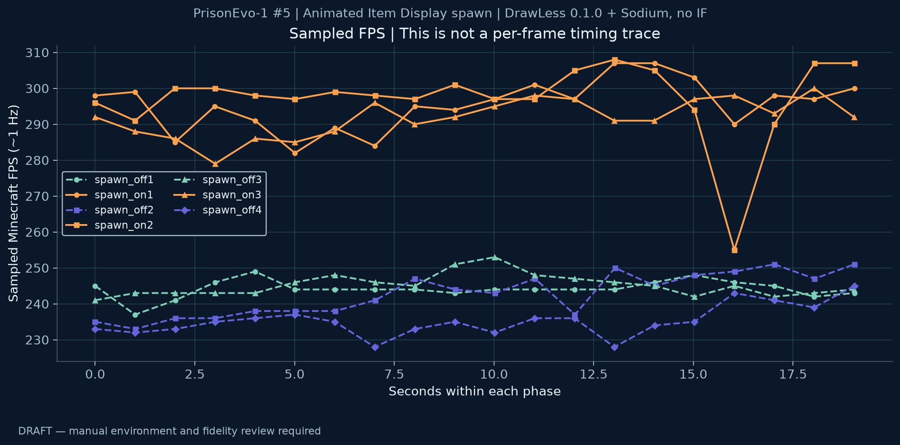
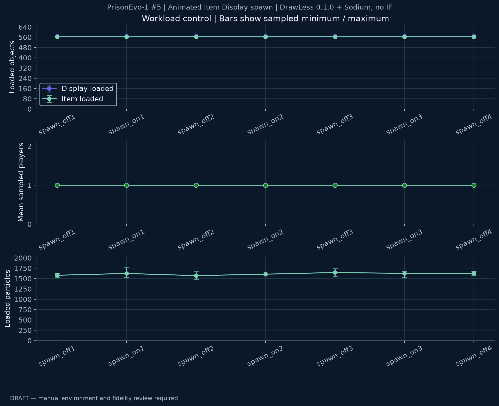

# PrisonEvo-1 #5 \| Animated Item Display spawn \| DrawLess 0.1.0 + Sodium, no IF

**DRAFT — manual review required; not a published claim.**

Mean paired FPS change: **+21.24%** across 3 ON runs.

Each ON is compared with the mean FPS of its adjacent OFF runs. No confidence interval is inferred.

## Review findings

- No automatic screening flags. Manual review is still required.

## Environment (declared by the operator)

| Field | Value |
|---|---|
| artifact | drawless-0.1.0.jar |
| artifact_sha256 | 3d69eb5f7ad88730327a97068b78c2c525a87948e7bbb960056454ca61eceb3b |
| source_commit | 297173ad4eb1f7f5aab9cce538367afd794d3e33 |
| cpu | AMD Ryzen 5 5600H (system inventory at analysis) |
| gpu | NVIDIA GeForce RTX 3060 Laptop GPU (recording-session log) |
| ram | 31.35 GiB usable physical RAM / nominal 32 GB (system inventory at analysis) |
| java | Java 25 (recording-session log); exact runtime build not recorded |
| driver | NVIDIA 610.62; OpenGL (recording-session log) |
| resolution | Maximized window (operator confirmed); exact framebuffer dimensions not recorded |
| vsync_and_fps_limit | VSync OFF; FPS unlimited during the series (operator confirmed) |
| graphics | Render distance 7, GUI scale 2, FOV 110 (probe); other graphics settings not recorded |
| resource_pack | Current instance resources.zip SHA-256 e1a080758b723da522bfb30d8089be00fbeb3ab036a2dd772d74c95bd8adc3e0; version at measurement not recorded |
| mods_with_versions | DrawLess 0.1.0; Sodium 0.9.2+mc26.2; Fabric API 0.161.0+26.2; Fabric Loader 0.20.0; Minecraft 26.2; no ImmediatelyFast (recording-session log) |
| jvm_heap_and_arguments | Not recorded for this session |
| power_mode | AC power, Performance mode (operator confirmed) |
| scene_and_mirror | PrisonEvo-1 #5 (operator confirmed); spawn/overworld-dbb2; camera -21.34 / 99.12 / 0.99; yaw 89.89, pitch 4.48, FOV 110 |
| date_and_timezone | 2026-10-16, reports completed 23:54:18–23:59:02, Europe/Moscow (UTC+03:00) |

Artifact hash and source association are operator declarations, not verified by this parser.

## Runs

| Phase | Role | Mean observed FPS | Input SHA-256 |
|---|---|---:|---|
| spawn_off1 | off | 243.24 | 7fc51a27493a133999a10a159c7d2a6e04bcfa272746ca2d811d7612e9f90001 |
| spawn_on1 | on | 295.31 | f7e392f98d91cd959f0c1dedafe73a19ea9e56bf7a84c5a36415046b5dbed7ea |
| spawn_off2 | off | 244.05 | 8f82da9e96b2bada78a3a4f64ca61ff7bd65c28f0983d9eb85bb07516d8a0a6e |
| spawn_on2 | on | 296.10 | 58ad8326e3bf530b827149532cc35fe306816cd674f3f875d44f931ea31a5df0 |
| spawn_off3 | off | 245.15 | a5e77f23a102ceb9a5cf2be302d63b2a2a41a7f41986565ae943688622bbee61 |
| spawn_on3 | on | 292.09 | b2ba73790f4ed83e1515ea5aa0fc477eaf8f3d5188a3c04cc3737e8a833e58d5 |
| spawn_off4 | off | 235.84 | 3c506e1b5025597304cc5de708cd0eefaec1449d4547a0ec104862a6d8b03a88 |

## Report contexts

- spawn_off1: Minecraft 26.2; DrawLess 0.1.0; dimension minecraft:spawn/overworld-dbb2; render distance 7; GUI scale 2; detailed profiler false; DrawLess enabled false; display model budget true; display budget us 500; adaptive display budget true; particle light cache false; particle empty collision false; particle visibility vanilla; NPC pose budget false; NPC groups/frame 2; adaptive NPC budget true; extreme display mode LIVE_CACHE; entire item scene true; pause display ticks false; Sodium true; ImmediatelyFast false
- spawn_on1: Minecraft 26.2; DrawLess 0.1.0; dimension minecraft:spawn/overworld-dbb2; render distance 7; GUI scale 2; detailed profiler false; DrawLess enabled true; display model budget true; display budget us 500; adaptive display budget true; particle light cache false; particle empty collision false; particle visibility vanilla; NPC pose budget false; NPC groups/frame 2; adaptive NPC budget true; extreme display mode LIVE_CACHE; entire item scene true; pause display ticks false; Sodium true; ImmediatelyFast false
- spawn_off2: Minecraft 26.2; DrawLess 0.1.0; dimension minecraft:spawn/overworld-dbb2; render distance 7; GUI scale 2; detailed profiler false; DrawLess enabled false; display model budget true; display budget us 500; adaptive display budget true; particle light cache false; particle empty collision false; particle visibility vanilla; NPC pose budget false; NPC groups/frame 2; adaptive NPC budget true; extreme display mode LIVE_CACHE; entire item scene true; pause display ticks false; Sodium true; ImmediatelyFast false
- spawn_on2: Minecraft 26.2; DrawLess 0.1.0; dimension minecraft:spawn/overworld-dbb2; render distance 7; GUI scale 2; detailed profiler false; DrawLess enabled true; display model budget true; display budget us 500; adaptive display budget true; particle light cache false; particle empty collision false; particle visibility vanilla; NPC pose budget false; NPC groups/frame 2; adaptive NPC budget true; extreme display mode LIVE_CACHE; entire item scene true; pause display ticks false; Sodium true; ImmediatelyFast false
- spawn_off3: Minecraft 26.2; DrawLess 0.1.0; dimension minecraft:spawn/overworld-dbb2; render distance 7; GUI scale 2; detailed profiler false; DrawLess enabled false; display model budget true; display budget us 500; adaptive display budget true; particle light cache false; particle empty collision false; particle visibility vanilla; NPC pose budget false; NPC groups/frame 2; adaptive NPC budget true; extreme display mode LIVE_CACHE; entire item scene true; pause display ticks false; Sodium true; ImmediatelyFast false
- spawn_on3: Minecraft 26.2; DrawLess 0.1.0; dimension minecraft:spawn/overworld-dbb2; render distance 7; GUI scale 2; detailed profiler false; DrawLess enabled true; display model budget true; display budget us 500; adaptive display budget true; particle light cache false; particle empty collision false; particle visibility vanilla; NPC pose budget false; NPC groups/frame 2; adaptive NPC budget true; extreme display mode LIVE_CACHE; entire item scene true; pause display ticks false; Sodium true; ImmediatelyFast false
- spawn_off4: Minecraft 26.2; DrawLess 0.1.0; dimension minecraft:spawn/overworld-dbb2; render distance 7; GUI scale 2; detailed profiler false; DrawLess enabled false; display model budget true; display budget us 500; adaptive display budget true; particle light cache false; particle empty collision false; particle visibility vanilla; NPC pose budget false; NPC groups/frame 2; adaptive NPC budget true; extreme display mode LIVE_CACHE; entire item scene true; pause display ticks false; Sodium true; ImmediatelyFast false

## Paired comparisons

| ON | Bracketed OFF FPS | ON FPS | Change |
|---|---:|---:|---:|
| spawn_on1 | 243.65 | 295.31 | +21.21% |
| spawn_on2 | 244.60 | 296.10 | +21.05% |
| spawn_on3 | 240.50 | 292.09 | +21.45% |

## Sampled CPU stages

CPU inclusive timings, ms/sampled frame. Do not add nested stages.

| Phase | Stage | ms/sampled frame |
|---|---|---:|
| spawn_off1 | Layer-cache refresh | 0.00033 |
| spawn_off1 | Item Display extraction (capture excluded) | 0.27184 |
| spawn_off1 | Visible entity extraction (inclusive) | 0.77560 |
| spawn_off1 | Item preparation group (inclusive) | 0.64195 |
| spawn_off1 | Staged vertex upload (all features) | 0.14948 |
| spawn_on1 | Layer-cache refresh | 0.04681 |
| spawn_on1 | Item Display extraction (capture excluded) | 0.16708 |
| spawn_on1 | Vanilla entity extraction loop (capture excluded) | 0.51844 |
| spawn_on1 | Live geometry capture | 0.39536 |
| spawn_on1 | Live eligibility (capture component) | 0.02455 |
| spawn_on1 | Live local pose (capture component) | 0.16231 |
| spawn_on1 | Live positioning/grouping (capture component) | 0.05021 |
| spawn_on1 | Live geometry upload | 0.03103 |
| spawn_on1 | Visible entity extraction (inclusive) | 1.01116 |
| spawn_on1 | Item preparation group (inclusive) | 0.06381 |
| spawn_on1 | Staged vertex upload (all features) | 0.04449 |
| spawn_on1 | Live geometry draw CPU | 0.07481 |
| spawn_off2 | Layer-cache refresh | 0.00016 |
| spawn_off2 | Item Display extraction (capture excluded) | 0.24843 |
| spawn_off2 | Visible entity extraction (inclusive) | 0.60269 |
| spawn_off2 | Item preparation group (inclusive) | 0.60538 |
| spawn_off2 | Staged vertex upload (all features) | 0.14143 |
| spawn_on2 | Layer-cache refresh | 0.04577 |
| spawn_on2 | Item Display extraction (capture excluded) | 0.17084 |
| spawn_on2 | Vanilla entity extraction loop (capture excluded) | 0.50277 |
| spawn_on2 | Live geometry capture | 0.27304 |
| spawn_on2 | Live eligibility (capture component) | 0.01980 |
| spawn_on2 | Live local pose (capture component) | 0.13960 |
| spawn_on2 | Live positioning/grouping (capture component) | 0.03278 |
| spawn_on2 | Live geometry upload | 0.02900 |
| spawn_on2 | Visible entity extraction (inclusive) | 0.86448 |
| spawn_on2 | Item preparation group (inclusive) | 0.06359 |
| spawn_on2 | Staged vertex upload (all features) | 0.04415 |
| spawn_on2 | Live geometry draw CPU | 0.07850 |
| spawn_off3 | Layer-cache refresh | 0.00018 |
| spawn_off3 | Item Display extraction (capture excluded) | 0.27247 |
| spawn_off3 | Visible entity extraction (inclusive) | 0.62616 |
| spawn_off3 | Item preparation group (inclusive) | 0.60906 |
| spawn_off3 | Staged vertex upload (all features) | 0.14117 |
| spawn_on3 | Layer-cache refresh | 0.04773 |
| spawn_on3 | Item Display extraction (capture excluded) | 0.16533 |
| spawn_on3 | Vanilla entity extraction loop (capture excluded) | 0.49727 |
| spawn_on3 | Live geometry capture | 0.24410 |
| spawn_on3 | Live eligibility (capture component) | 0.01707 |
| spawn_on3 | Live local pose (capture component) | 0.12720 |
| spawn_on3 | Live positioning/grouping (capture component) | 0.02919 |
| spawn_on3 | Live geometry upload | 0.02596 |
| spawn_on3 | Visible entity extraction (inclusive) | 0.83090 |
| spawn_on3 | Item preparation group (inclusive) | 0.06240 |
| spawn_on3 | Staged vertex upload (all features) | 0.04620 |
| spawn_on3 | Live geometry draw CPU | 0.07592 |
| spawn_off4 | Layer-cache refresh | 0.00018 |
| spawn_off4 | Item Display extraction (capture excluded) | 0.26929 |
| spawn_off4 | Visible entity extraction (inclusive) | 0.64790 |
| spawn_off4 | Item preparation group (inclusive) | 0.63021 |
| spawn_off4 | Staged vertex upload (all features) | 0.15112 |

## Live cache costs

Ranges cover sampled frames only. Counter deltas cover the first-to-last sample interval, not the full run.

Tracked buffer bytes are not total VRAM; upload bytes/frame are traffic. CPU timings are not GPU time.

| Phase | Metric | Value |
|---|---|---|
| spawn_on1 | localBytes_sampled_range | [518912.0, 518912.0] |
| spawn_on1 | indexBytes_sampled_range | [115920.0, 116496.0] |
| spawn_on1 | meshes_sampled_range | [210.0, 210.0] |
| spawn_on1 | instances_sampled_range | [282.0, 286.0] |
| spawn_on1 | fallback_sampled_range | [47.0, 51.0] |
| spawn_on1 | draws_sampled_range | [1.0, 1.0] |
| spawn_on1 | counter_interval_frames | 5617.0 |
| spawn_on1 | counter_interval_seconds | 19.04 |
| spawn_on1 | captureTotalMs_per_frame | 0.17291490119280756 |
| spawn_on1 | uploadTotalMs_per_frame | 0.02601851522164857 |
| spawn_on1 | drawTotalMs_per_frame | 0.07569627915257256 |
| spawn_on1 | instanceUploadedBytes_per_frame | 36456.32330425494 |
| spawn_on2 | localBytes_sampled_range | [518912.0, 518912.0] |
| spawn_on2 | indexBytes_sampled_range | [115968.0, 116496.0] |
| spawn_on2 | meshes_sampled_range | [210.0, 210.0] |
| spawn_on2 | instances_sampled_range | [283.0, 286.0] |
| spawn_on2 | fallback_sampled_range | [47.0, 50.0] |
| spawn_on2 | draws_sampled_range | [1.0, 1.0] |
| spawn_on2 | counter_interval_frames | 5662.0 |
| spawn_on2 | counter_interval_seconds | 19.04 |
| spawn_on2 | captureTotalMs_per_frame | 0.17137513246202757 |
| spawn_on2 | uploadTotalMs_per_frame | 0.026772165312610386 |
| spawn_on2 | drawTotalMs_per_frame | 0.0757038149063935 |
| spawn_on2 | instanceUploadedBytes_per_frame | 36444.009890498055 |
| spawn_on3 | localBytes_sampled_range | [518912.0, 518912.0] |
| spawn_on3 | indexBytes_sampled_range | [116016.0, 116496.0] |
| spawn_on3 | meshes_sampled_range | [210.0, 210.0] |
| spawn_on3 | instances_sampled_range | [283.0, 286.0] |
| spawn_on3 | fallback_sampled_range | [47.0, 50.0] |
| spawn_on3 | draws_sampled_range | [1.0, 1.0] |
| spawn_on3 | counter_interval_frames | 5556.0 |
| spawn_on3 | counter_interval_seconds | 19.03 |
| spawn_on3 | captureTotalMs_per_frame | 0.15249172066234704 |
| spawn_on3 | uploadTotalMs_per_frame | 0.026291036717062635 |
| spawn_on3 | drawTotalMs_per_frame | 0.07734863210943126 |
| spawn_on3 | instanceUploadedBytes_per_frame | 36456.50107991361 |

## Particle workload

All loaded particles, not only visible particles. Ranges are sampled minima/maxima.

| Phase | Mean loaded | Sampled range | Tick ms/tick | Extraction ms/frame |
|---|---:|---|---:|---:|
| spawn_off1 | 1580.40 | 1524–1624 | 1.27300 | 0.13774 |
| spawn_on1 | 1624.25 | 1532–1766 | 1.30757 | 0.13189 |
| spawn_off2 | 1571.95 | 1485–1665 | 1.27391 | 0.14233 |
| spawn_on2 | 1606.90 | 1563–1663 | 1.27685 | 0.12361 |
| spawn_off3 | 1646.90 | 1550–1743 | 1.33752 | 0.14456 |
| spawn_on3 | 1626.45 | 1525–1677 | 1.31184 | 0.13040 |
| spawn_off4 | 1629.55 | 1572–1679 | 1.33522 | 0.15126 |

## Notes

- All seven requested reports are included, with 20 scene samples each. There are no menu or unfocused measured frames.
- Only the DrawLess master switch changes in the recorded contexts. Particle experiments and NPC pose budgeting remain OFF.
- Operator confirms NPC appearance, animation, lighting and visible parts looked unchanged in ON. Independent synchronized image parity is not established; a labelled original screenshot pair is supplied; different pixel dimensions and temporal phases are documented in provenance.json.
- Installed JAR hash was rechecked after the series and matches the archived 0.1.0 release artifact. Source commit association is the local release reference, not reconstructed from bytecode.
- Exact framebuffer size, graphics details, runtime build, JVM flags and resource-pack version at measurement were not recorded; those limitations are retained.
- Current options.txt differs from the measurement and is not used as historical evidence. FPS limit/VSync/power statements above are operator confirmation.
- All controls retained: OFF4 is lower than the preceding controls. Three bracketed ON comparisons are preliminary repeated observations, not independent-session significance estimates.
- The session log confirms only DrawLess, Sodium, Fabric API/Loader and their dependencies; no IF. Raw session logs are not exported because they contain unrelated private data.
- The protocol requested warmup and post-switch waits, but their execution is not independently recorded.

## Missing evidence

- No per-frame percentiles, 1% low, GPU elapsed time or recorder-overhead calibration.
- Original OFF/ON screenshots and animation review must be supplied separately.
- Counts and unchanged rounded camera samples do not prove identical visible output.
- Preserve all original inputs and their hashes; review privacy before publishing raw files.
