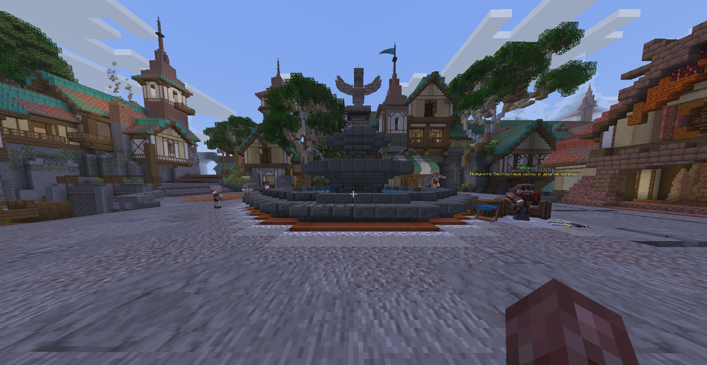
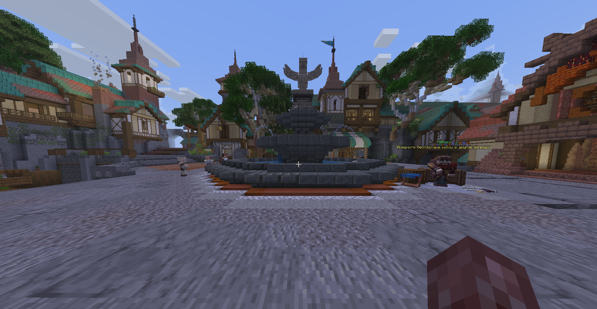

# DrawLess / Benchmark 01 — animated Item Display spawn

**Measured results.** Recorded 2026-10-16, analysed 2026-10-17.
An original labelled screenshot pair is included. Exact framebuffer dimensions
during the benchmark were not recorded.

[Page card (PNG)](modrinth-card.png) · [Editable layout (SVG)](modrinth-card.svg)

DrawLess 0.1.0 with Sodium, without ImmediatelyFast, improved mean observed FPS by
**21.24% across three bracketed ON comparisons** in this scene. Each ON is compared
with the mean FPS of the OFF runs immediately before and after it. The mean of those
three baseline values is **242.91 FPS**; mean ON is **294.50 FPS**. The headline is the
mean of the three percentage changes, rather than a comparison of selected best runs.

This measures the default DrawLess optimization set against its master switch OFF.
It does not isolate one cache, compare against ImmediatelyFast, or establish gains
for other scenes, computers or GPU-bound settings.

## Every recorded phase

| Order | Phase | Mean observed FPS | Adjacent OFF baseline | Paired change |
|---:|---|---:|---:|---:|
| 1 | OFF1 | 243.24 | — | — |
| 2 | ON1 | 295.31 | 243.645 | +21.205% |
| 3 | OFF2 | 244.05 | — | — |
| 4 | ON2 | 296.10 | 244.600 | +21.055% |
| 5 | OFF3 | 245.15 | — | — |
| 6 | ON3 | 292.09 | 240.495 | +21.454% |
| 7 | OFF4 | 235.84 | — | — |

[](phase-fps.png)

All seven submitted reports are retained. OFF4 is lower than the previous controls:
OFF max-minus-min divided by mean is **3.85%**. Bracketing incorporates this control;
it cannot remove arbitrary server changes, thermal drift or time-order effects.
The unpaired means of all four OFF and all three ON runs are 242.07 and 294.50 FPS;
those are a different calculation and are not the chosen headline baseline.

Three ON runs in one session are preliminary repeated observations, not three
independent sessions or a statistical confidence estimate. No p99/1% low is derived
from the once-per-second displayed-FPS samples.

## Scene and fidelity

PrisonEvo-1 #5, dimension `spawn/overworld-dbb2`, camera XYZ `-21.34 / 99.12 / 0.99`,
yaw/pitch `89.89 / 4.48`, FOV 110, render distance 7, GUI scale 2.

Across all **140 scene samples**: 569 loaded Display entities, 563 Item Display,
407 bone carriers, 530 custom-model-data items, 439 passengers and one player.
Recorded camera values are identical. Each phase completed with 20 samples;
menu frames excluded and unfocused measured frames are both zero in every report.

Bone-carrier count does not mean every carrier is an animated bone. The sample
reports do not establish visibility for every pixel or continuous camera immobility.

The operator reports that NPC appearance, animation, lighting and visible parts
looked unchanged in every ON phase. NPC pose budgeting, tick pausing, particle-light
and particle-collision experiments were OFF. This is an observation and supporting
counter evidence, not a synchronized pixel-parity test.

### Original scene screenshots

Labels follow the supplied filenames. The originals are retained byte-for-byte:
OFF is 1919×993 pixels and ON is 1918×995. Their different dimensions and different
animation/cloud/particle phases preclude direct whole-image pixel-parity claims;
they do not establish the framebuffer size used during the timed phases.





| Phase | Mean loaded particles | Sampled minimum–maximum |
|---|---:|---:|
| OFF1 | 1580.40 | 1524–1624 |
| ON1 | 1624.25 | 1532–1766 |
| OFF2 | 1571.95 | 1485–1665 |
| ON2 | 1606.90 | 1563–1663 |
| OFF3 | 1646.90 | 1550–1743 |
| ON3 | 1626.45 | 1525–1677 |
| OFF4 | 1629.55 | 1572–1679 |

The particle population fluctuates naturally and is not identical between phases.
ON does not achieve the result with a consistently smaller loaded population.
Loaded counts are not visible-particle counts.


## What the optimization costs

The following CPU values use cumulative counter differences over the first-to-last
sample intervals of the ON runs, weighted by their combined **16,835 frames**.
These intervals omit the recording edges and are already warm. They do not measure
cold-start construction, all mod overhead, recorder overhead or GPU execution.

| Measured work | CPU ms/frame |
|---|---:|
| Live geometry capture | 0.16566 |
| Live upload submission | 0.02636 |
| Live draw submission | 0.07624 |

These are specific CPU scopes, not an exhaustive accounting of optimization cost.
Model-layer refresh is outside this three-component breakdown. Do not add these
values to an inclusive extraction scope that already contains their work.

[](cache-cpu.png)

- Shared local geometry: **518,912 bytes = 506.75 KiB**, 210 retained meshes.
- Sampled index buffers: **115,920–116,496 bytes** across ON runs.
- Instance-buffer traffic: weighted **36,452 bytes/frame ≈35.60 KiB/frame**.
- Cached parts per sampled frame: **282–286**; one cached-scene draw per sampled frame.
- Ordinary prepared Item Display states: 333 in OFF, 47–51 in ON. These exclude
  GPU-cached parts and include 32 empty states; fewer prepared states are not proof
  that visible models disappeared.
- No new mesh builds or local-geometry uploads between the first and last ON samples.
  Index rebuilds were 31 / 26 / 29 in those intervals. This does not mean the initial
  cache was free to construct.
- In every ON model-budget sample: 293 layer reuses, zero builds/deferred updates,
  eight bypasses. These are sampled model-layer counters, not a universal hit rate.

Tracked buffers are not total GPU memory; traffic per frame is not retained VRAM.

The ordinary item-preparation group averaged **0.62165 → 0.06327 ms/sampled frame**
across the OFF/ON runs. Meanwhile inclusive visible-entity extraction became more
expensive because it contains the new cache work. All sampled stage values and the
nesting limitations are preserved in the [generated appendix](appendix.md); no sum
of those stages is presented as the complete frame-time saving.

## Environment and evidence provenance

- JAR: `drawless-0.1.0.jar`, SHA-256
  `3d69eb5f7ad88730327a97068b78c2c525a87948e7bbb960056454ca61eceb3b`.
  The installed file was checked after recording and matches the archived 0.1.0 artifact.
- The recording-session log identifies Minecraft 26.2, Fabric Loader **0.20.0**,
  Fabric API 0.161.0+26.2, DrawLess 0.1.0 and Sodium 0.9.2+mc26.2; no ImmediatelyFast.
- GPU/driver from that log: NVIDIA GeForce RTX 3060 Laptop GPU, NVIDIA 610.62, OpenGL.
- CPU from system inventory at analysis: AMD Ryzen 5 5600H; nominal 32 GB system RAM.
- Operator-confirmed settings: maximized window, unlimited FPS, VSync OFF,
  AC power and Performance mode.
- Java major version 25 is logged. Exact Java build, JVM heap/arguments, exact
  framebuffer size and the complete graphics preset were not captured.
- Current instance `resources.zip` hashes to
  `e1a080758b723da522bfb30d8089be00fbeb3ab036a2dd772d74c95bd8adc3e0`.
  Its version/content identity at measurement is not independently established.
- Current `options.txt` differs from the measured configuration and is not treated
  as historical evidence. The requested warmup/wait procedure was not independently recorded.

These missing details limit exact reproduction; they are not silently filled from
current settings. Original session logs contain unrelated private data and are not
published. Selected provenance and operator statements are described in
`provenance.json` and `series.json`.

## Raw inputs and reproduction

All seven original reports are preserved byte-for-byte in [raw/](raw/), with SHA-256
identities in `summary.json` and the appendix. The [series manifest](series.json)
uses paths relative to this directory. With Python/Matplotlib installed:

```sh
python tools/benchmarks/report.py --manifest benchmarks/results/spawn-20261016/series.json --output build/spawn-reproduction --reviewed-plots phase-fps cache-cpu
```

The output directory must be new/empty. This reproduces the numerical appendix and
plots; the selected phase-FPS and cache-CPU figures use the reviewed presentation.
Their source and export hashes are recorded in [figure-exports.json](figure-exports.json).
The generated appendix and other plots remain draft outputs; this narrative is a
separate review of the evidence. See the general
[methodology](../../METHODOLOGY.md).


